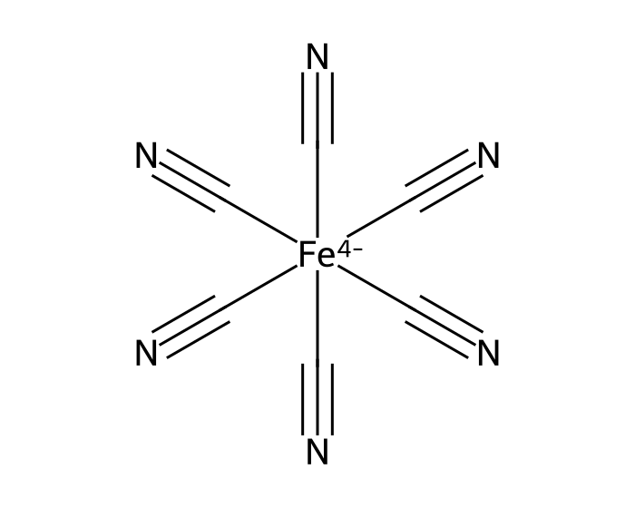
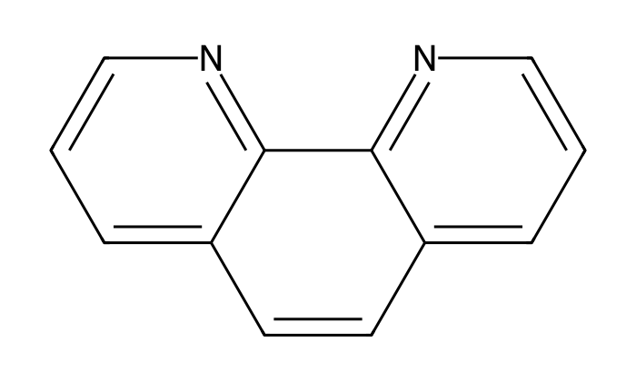

# Session 6: Batch file handling and automated reporting

Tuesday, October 20. This is the first session whose product is a set of files rather than a number or a plot. You first take an inventory of a folder of spectra, then read every file with one function in a loop, and finally write a summary table and a short report from the same run.

## Learning objectives

By the end of this session you can:

1. Build a file inventory with `pathlib`, one row per file with the day, setting, and role from its folder and file name, and check its count against the laboratory's own list before any file is read.
2. Write one function that reads a spectrum and returns the value at the analytical wavelength, and apply it to every file in a loop that collects a list of dictionaries into one table.
3. Log each file the loop cannot read, with its name and error, and show that the rows read plus the files logged equal the number of files in the inventory.
4. Decide whether a file that needed a different reader goes into the result, from the concentration, standard deviation, and n with and without it. Write the summary table and the report from the same run, with the run name as the only input a new run changes.

**AI practice.** *Give the assistant a check to run.* Before TASK 2, you ask the assistant what the `except` block should keep, then ask it to run its loop in your notebook and print the files read and the files logged beside the sequence table's count. You then decide whether those printed counts, not the assistant's sentence about them, show that every file is accounted for.

## 0. Ferrocyanide and iron, the two analytes

Section 1 of the activity measures ferrocyanide, the hexacyanoferrate(II) ion, [Fe(CN)₆]⁴⁻. Six cyanide ligands sit at the corners of an octahedron around one iron(II) ion. Ferrocyanide is pale yellow in water and absorbs in the near ultraviolet, which is why the activity reads it at 360 nm. The FlareLab group at the University of Cambridge measured ferrocyanide standards to test quantitative UV-Vis on its instrument.



*Figure 1. Ferrocyanide, the hexacyanoferrate(II) ion.*

Sections 2 and 3 measure dissolved iron as a colored complex. A reducing agent converts any iron(III) in the sample to iron(II), and three molecules of 1,10-phenanthroline then bind each iron(II) ion. The product, tris(1,10-phenanthroline)iron(II), is orange-red and absorbs most strongly at 510 nm, so its absorbance there is proportional to the iron in the sample.



*Figure 2. 1,10-Phenanthroline, the ligand that binds iron(II) three to one.*

The EPA's secondary drinking water standard for iron is 0.3 mg/L, and the EPA states that above it iron can give water a rusty color and a metallic taste and leave reddish or orange stains. The standard addresses taste and appearance, not health, and the EPA does not enforce it, whereas Washington requires a new water system to treat for iron above 0.3 mg/L (WAC 246-290-320). See the EPA's [secondary drinking water standards](https://www.epa.gov/sdwa/secondary-drinking-water-standards-guidance-nuisance-chemicals) page and PubChem's records for [ferrocyanide](https://pubchem.ncbi.nlm.nih.gov/compound/9552077) and [1,10-phenanthroline](https://pubchem.ncbi.nlm.nih.gov/compound/1318).

## 1. Finding every file in a folder

Today's real dataset is two days of ferrocyanide standards from FlareLab: 78 files in two folders, one per day. Each file is a dark spectrum, a water reference, or one of eleven standards from 0.001 to 100 mM, and each was measured at three distance settings of the instrument, 50 mm, 200 mm, and 550 mm. A loop reads all 78 in a second and reads every file the same way.

A path is the address of a file: the folders that lead to it, then its name. `Path` from `pathlib` holds a path as an object that knows its own parts. `path.name` is the file name, `path.stem` is the name without its extension, and `path.parent.name` is the folder the file sits in. `DATA_DIR.glob("*.txt")` lists the files in one folder whose names match the pattern, where `*` stands for any run of characters, and `rglob` does the same in every folder below. Today `glob` returns 0 files, because the spectra are one level down, and `rglob` returns 78. A pattern that matches nothing raises no error. It returns an empty list, and every later cell runs on nothing without complaint. Wrap the result in `sorted`, because the file system's order differs between a Windows laptop and a Mac and `sorted` gives both the same order.

## 2. The inventory before the loop

The inventory is a table with one row per file, built from the paths alone. The FlareLab file names record the facts, separated by underscores: `LE_240409_d_50_mm_ferrocyanide_counts_v5_...` is day 240409, distance setting 50 mm, role `ferrocyanide`, and standard `v5`. Session 5's `split("_")` takes the stem apart, and a loop appends one dictionary per path to a list that `pd.DataFrame` turns into the table. Start the list empty in the same cell, `rows = []`, so that running the cell twice builds the table once.

The laboratory kept its own list of what it measured, the parameter table. It has 213 rows, one per ferrocyanide file over four days, and gives the concentration of each standard. Keep the 78 rows for the two days here and compare them with the inventory by count and by name before a spectrum is read. The file name carries only the standard's version, such as `v5`, so a `merge` on the file name is also how each standard gets its concentration.

## 3. One function for every file

Write the reading once, as a function, and call it on every file. A Flame export opens with a header of instrument settings and then the line `>>>>>Begin Spectral Data<<<<<`. `read_flame` finds that line, as session 4 found the end of a JCAMP header, and hands the lines after it to `np.loadtxt`. `counts_at(path, wavelength_nm)` calls `read_flame` and returns the counts at one wavelength with `np.interp`. The loop calls `counts_at` on every path in the inventory and builds the table as in section 2.

Absorbance needs three spectra from the same day and setting: A = -log10((S - D) / (R - D)), i.e., minus the base 10 logarithm of the standard's counts S over the water reference's counts R, each with the dark counts D subtracted. A `merge` on day and distance setting attaches the matching dark and reference counts to each of the 66 standards. Because absorbance is a ratio of counts, the points from the three settings fall on one line.

The worked calculation. At 360 nm, the 12 day 1 standards from 0.5 to 10 mM give a slope m = 0.09168 AU per mM, an intercept b = 0.00877 AU, and R^2 = 0.99926. Below 0.5 mM the absorbance is within 0.01 AU of zero. At 50 and 100 mM it stops near 1.8 AU, where almost no light reaches the detector, so those standards are outside the calibration. Day 2's 1 mM standard at 50 mm reads A = 0.0963 AU. Its concentration is c = (A - b) / m, i.e., its absorbance less the intercept, divided by the slope: (0.0963 - 0.00877) / 0.09168 = 0.955 mM, a recovery of 95.5%. Over the three settings, the day 2 standards recover 94.5% at 1 mM, 112.8% at 5 mM, 109.0% at 10 mM, and 161.1% at 0.5 mM. Only 0.5 mM falls outside the 85 to 115% acceptance window, and it does so at every setting. A high reading at every setting points to the day 2 0.5 mM solution, not to one measurement. The report shows it because every file was counted and read: 78 files found, 78 in the parameter table, 78 read, and 0 logged.

## 4. Logging the files the loop cannot read

Each run in section 2 of the activity has a sequence table, the instrument's list of the file it wrote at each position. In your run, one file raises an error when it is read. A plain loop stops at that file, which is harmless: nothing is reported until the file is dealt with. `try` and `except` let the loop go on. Python runs the `try` block, and if a line in it raises an error, Python skips the rest of the block and runs the `except` block instead, with the error stored in `err`.

```python
for path in run_paths:
    try:
        name = f"{path.parent.name}/{path.name}"
        run_rows.append({"file": name, "absorbance_AU": absorbance_at(path, IRON_NM)})
    except Exception as err:
        ...   # what the run keeps about this file
```

What goes in the `except` block is the decision. `continue` or `pass` keeps nothing. The loop finishes, the table has one row fewer, and nothing records that a file is missing. Appending `{"file": name, "error": str(err)}` to a list of failures keeps the evidence for the report. Either way the loop finishes, so check the arithmetic, as for a mass balance: the number of rows read plus the number of files logged must equal the number of files in the sequence table. With 16 files in a run and one that raises an error, that is 15 + 1 = 16. With `continue` it is 15 + 0, and that sum is the only place the missing file shows.

## 5. Writing the report from the run name

The last cells write two files to `output/`: the summary table with `to_csv`, and a short report built line by line with f-strings and written with `write_text`. `OUTPUT_DIR.mkdir(exist_ok=True)` makes the folder if it is missing. The repository ignores `output/`, so `git pull` never conflicts with your report, which every run overwrites. Every value in the report comes from a variable, including the file counts on its first line, so setting `RUN` to another run writes that run's report with no other change.

## 6. Today

Set `RUN` in Parameters to the run assigned to you on the board; nothing is downloaded. Section 2 builds your run's inventory and counts it against its sequence table (TASK 1), replaces the `raise` line in the loop's `except` block (TASK 2), and checks the rows read plus the files logged against the sequence table (TASK 3). Section 3 reads that file and compares two treatments of it with 0.3 mg/L. In TASK 4 you choose one for your report. A sample the loop skipped is a well that was never judged.

The judgment cell is scored 0 to 2 by the rubric in the syllabus, in the format on the AI practices page. Part (a) asks which treatment your report uses and why, with the affected water's concentration, standard deviation, and n under each and whether either changes its comparison with 0.3 mg/L. It also asks what the summary and the report would have said had the `except` block kept nothing. Part (b) is one entry, from the prompt before TASK 2, with a reason from your run. To submit, click **Restart**, then **Run All**, save, and upload `activity.ipynb` to Canvas by 1:30 pm on Thursday, October 22. A finished loop proves only that it finished. The count proves that it read everything.
