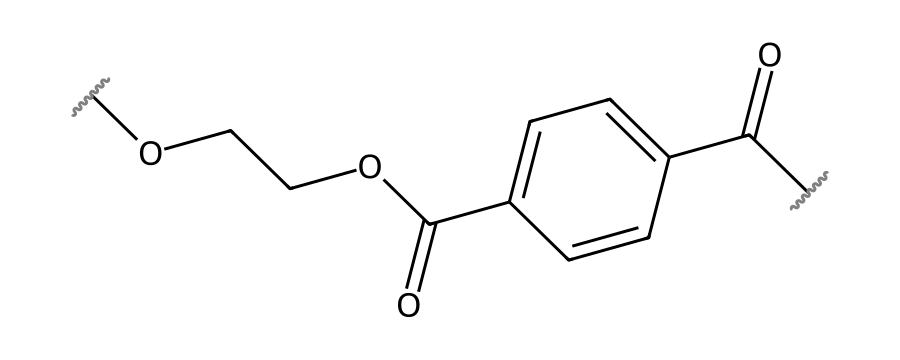
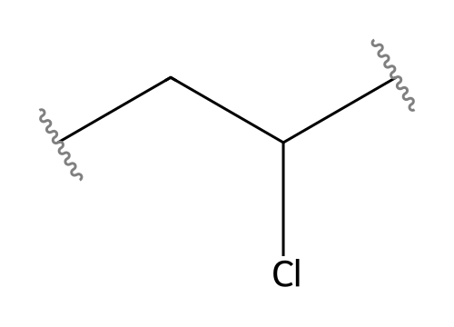
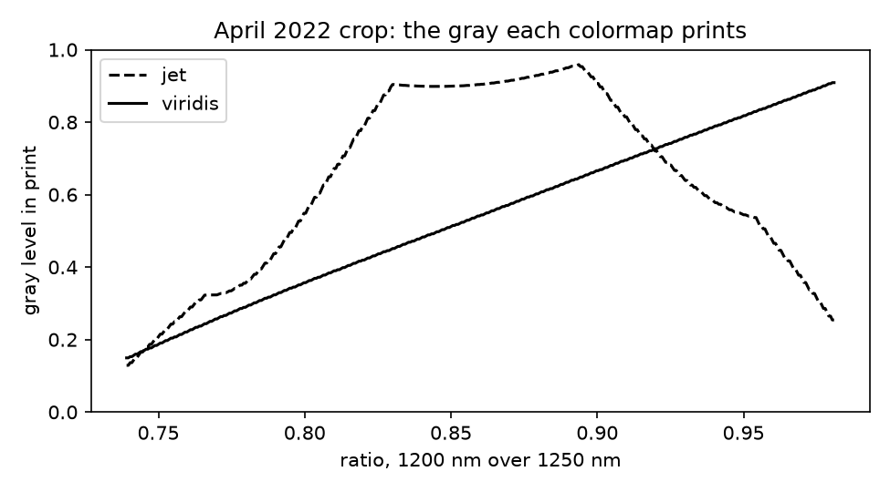

# Session 7: Visualization for chemical measurements

Thursday, October 22. This is the first session whose result is a figure that someone else acts on, made from a hyperspectral image in which every pixel has a spectrum. You first read a real image one band at a time, then plan and make a sorting-line operator's figure for your own band pair, and finally decide which pixels go into each polymer's spectrum.

## Learning objectives

By the end of this session you can:

1. Read a hyperspectral cube one band at a time with `imread`, and find from the values which bands carry no signal and which pixels lie outside the image.
2. Make a band-ratio map with a perceptually uniform colormap, color limits from percentiles, and a labeled colorbar. Show with a grayscale view the boundaries that a rainbow colormap draws where the ratio changes smoothly.
3. Plot each polymer's mean spectrum beside the map, with the series told apart by line style and marker. Choose which pixels go into each mean when lamp glare clips some of them.
4. Plan a figure in words before any code, and change the plan where it would hide the difference between PET and PVC.

**AI practice.** *Explore and plan before code.* Before TASK 2, you ask the assistant, in plan mode, to describe the operator's figure in words: its colormap, its color limits, how its series are told apart, and every label. You then decide, in comments on the plan before any code exists, whether its colormap and limits let the operator tell PET from PVC.

## 0. PET and PVC, the two polymers to tell apart

PET, poly(ethylene terephthalate), is a polyester. Each repeat unit joins a terephthalate group, a benzene ring with an ester at each end, to the two carbons of ethylene glycol. PET is the clear plastic of drink bottles and food trays and carries resin identification code 1.

*Figure 1. The repeat unit of PET, poly(ethylene terephthalate).*

PVC, poly(vinyl chloride), is a carbon chain with a chlorine atom on every second carbon. It is used for pipes, window frames, and clear blister packs, and carries resin identification code 3.

*Figure 2. The repeat unit of PVC, poly(vinyl chloride).*

At the temperatures where PET is melted for reuse, above 250 °C, PVC decomposes and releases hydrogen chloride, which breaks PET's ester bonds and yellows the recycled resin. Clear PET and clear PVC look alike and have overlapping densities, so their spectra are what separates them. Both absorb in the shortwave infrared (SWIR) through overtones and combinations of their C–H stretching vibrations, and a C–H bond on a benzene ring absorbs at different wavelengths from one on a carbon that carries a chlorine. The EPA reports that 29.1 percent of PET bottles and jars were recycled in 2018 ([plastics material-specific data](https://www.epa.gov/facts-and-figures-about-materials-waste-and-recycling/plastics-material-specific-data)).

## 1. Reading a hyperspectral cube one band at a time

At a recycling plant, an operator reads a SWIR camera's false-color map of a belt of mixed flakes and decides which flakes go to the PET bale. PVC in a PET bale spoils the melt and the reclaimer rejects the bale, whereas PET sent to the wrong bin goes to landfill. The plant's own rule, not a published standard, sends a flake to the bin its spectrum matches.

A **hyperspectral camera** records one grayscale image for each narrow band of wavelengths. The band images, stacked in wavelength order, make a **cube** with two axes of position and one of wavelength. The spectrum of a pixel is that pixel's value read from every band in turn. Today's real cube is a drone survey that Balsi, Moroni, and Bouchelaghem flew in April 2022 over plastic objects laid on grass, 81 bands from 900 to 1700 nm. You work on a crop of 400 by 1085 pixels around one PVC object. Each value is a **digital number** (DN), the camera's raw 8-bit signal, not yet reflectance.

Read the cube one band at a time, because a ratio needs only two bands, and check the values before you trust them. In the crop, 900 and 910 nm are zero everywhere, 920 nm reaches 2 DN, and 930 nm reaches 4 DN, so those bands carry no signal. At 1250 nm, 16.9% of the pixels are zero, because they lie outside the mosaic of flight lines and were never measured. Those zeros mean no data, so set them to `np.nan` before any ratio is taken. `np.nan` is NumPy's value for "not a number", and Matplotlib leaves it blank.

## 2. Canceling brightness with a band ratio

A pixel's brightness depends on the light it catches as well as on what it is made of. To remove the lighting, divide a band where the material absorbs by a nearby band where it does not. Both bands scale with the same lighting, so only the depth of the absorption remains.

The worked calculation uses the mean spectra over the whole survey, in `data/apr22_spectra.csv`. PVC reads 100.0 DN at 1200 nm and 134.1 DN at 1250 nm, so its ratio is r = 100.0 / 134.1 = 0.746. Grass gives 102.3 / 107.7 = 0.950, and PET gives 125.3 / 131.5 = 0.953. This ratio separates PVC from grass and leaves PET where grass is. Choosing a band pair is choosing which materials the map can tell apart.

Note that a ratio cancels brightness but not thickness. A thicker flake absorbs more, so its band is deeper and its ratio moves further from 1. In the test batch, flakes of one polymer differ in thickness and so spread over a range of ratios.

## 3. Choosing a colormap that keeps the order of the values

A **colormap** turns each number into a color. The eye reads lightness as order: a lighter color looks like a larger value. A colormap is **perceptually uniform** when its lightness rises steadily with the value, so that equal steps in the value look like equal steps in color. `viridis` is one. A rainbow colormap such as `jet` runs from dark blue through light cyan and yellow to dark red, so its lightness rises and then falls.

*Figure 3. The gray level that jet and viridis print for each ratio on the crop's color limits. Look for where jet's line turns over.*

On the crop's color limits, jet prints a ratio of 0.739 at gray level 0.13, 0.850 at 0.90, and 0.981 at 0.25, whereas viridis rises from 0.15 to 0.91. The ratio passes 0.85 at the edge of the PVC object, so jet draws a bright ring there that reads as a boundary, although the ratio changes smoothly. The object's core and the brightest grass sit at jet's two dark ends, so they print alike.

The **grayscale test** catches both: redraw the map in grayscale and check that the order of the values survives. The test also stands in for a reader with a color vision deficiency. The National Eye Institute's [page on color blindness](https://www.nei.nih.gov/learn-about-eye-health/eye-conditions-and-diseases/color-blindness) states that about 1 in 12 men have one, and that the most common type makes red and green hard to tell apart. A display that puts three bands into red, green, and blue serves that reader poorly. With 1550, 1200, and 1250 nm as red, green, and blue, the crop's PVC object is magenta and the grass teal at nearly the same lightness. A simulated view for that reader keeps about a third of the contrast, and a grayscale print almost none. Three labeled grayscale panels carry the same information.

## 4. Setting color limits, colorbars, and scale bars

The **color limits** are the two values mapped to the ends of the colormap, `vmin` and `vmax` in `imshow`. When no limits are given, `imshow` uses the minimum and maximum. In the crop, a few pixels at the mosaic's edge stretch the ratio from 0.067 to 19.0, so grass and plastic are drawn in nearly one dark color. Limits at percentiles fix this. The 1st **percentile** is the value below which 1% of the pixels lie. The 1st and 99th percentiles of the crop's ratio are 0.739 and 0.981, and limits there spend the colors on the grass and the plastic.

A **colorbar** is the figure's key from color back to number, and its label names the quantity and the two bands. A **scale bar** is a line of known length that lets the operator judge flake sizes. The test batch is imaged at 2.0 mm per pixel, so its map carries a 50 mm bar. The paper gives the survey's pixels only as 1 to 2 cm across, so the crop's axes stay in pixels.

## 5. Choosing the pixels that make a spectrum

A **mask** is an image the size of the band images, 255 where a pixel belongs to a material and 0 elsewhere. Masks are usually drawn generously. The survey's PVC mask holds 78,436 pixels in the crop, many of them grass, and the median ratio inside it is 0.802, between PVC's 0.746 and grass's 0.950.

On a belt, masks also hold glints. A **glint** is a spot where the lamp reflects off a glossy flake. A glint is brighter than the camera can record, so the camera **saturates**: it records its largest number, 255, whatever the true signal. A pixel at 255 in both bands has a ratio near 1 whatever the polymer. The activity's section 3 builds each spectrum from every masked pixel and again without the saturated ones. The first treatment needs no threshold, whereas the second shows the flakes rather than the lamp but rests on one. Which one belongs on the operator's display is the decision.

## 6. Planning the figure before the code

A figure holds many choices: the colormap, the limits, the panels, the series, the labels, and the scale. In plan mode the assistant writes those choices out in words, as a document you can comment on, before any code. Are its limits the minimum and maximum, or percentiles? Would its colormap keep the order of the values in grayscale? Are the series told apart without color? Change the plan in its comments, then write the code from it.

## 7. Today

Set `NUMERATOR_NM` and `DENOMINATOR_NM` in Parameters to the band pair assigned to you on the board; nothing is downloaded. Section 2 reads your pair in the test batch (TASK 1), makes the operator's figure from your edited plan (TASK 2), and puts numbers on the map (TASK 3).

The judgment cell is scored 0 to 2 by the rubric in the syllabus. Part (a) asks whether your figure lets the operator tell PET from PVC and which treatment you would build the display on, with your medians and the PVC minus PET difference under both. Part (b) is one entry with a reason from your output, and the plan before TASK 2 is its natural source. To submit, click **Restart**, then **Run All**, save, and upload `activity.ipynb` to Canvas by 1:30 pm on Tuesday, October 27. A map is evidence only when its colors keep the order of its numbers.
