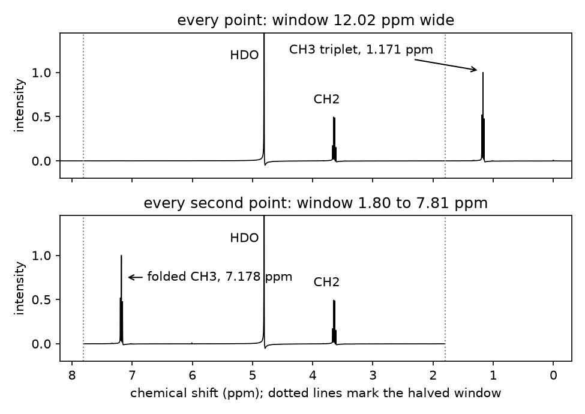

# Session 10: Fourier analysis

Tuesday, November 3. The scientist who sets up a routine ¹H method on a shared NMR spectrometer chooses how long the receiver listens after each pulse. A shorter listen means shorter scans and more samples per instrument hour. Today you find how short that can be and still show ethanol's CH₃ triplet as three lines, on a real free induction decay from the [Biological Magnetic Resonance Data Bank](https://bmrb.io/metabolomics/mol_summary/show_data.php?id=bmse000297).

## Learning objectives

By the end of this session you can:

1. Turn a signal recorded in time into a frequency spectrum with `numpy.fft`, with an axis in Hz and ppm from the instrument's acquisition parameters, and check the axis against a known coupling.
2. Predict where a signal whose frequency lies beyond the sampling limit appears in a spectrum, and confirm the prediction on measured data.
3. Shorten a recorded signal to a series of acquisition times and find the shortest that still separates closely spaced peaks, comparing the resolution that time allows with the peaks' spacing and width.
4. Choose between stopping a signal abruptly and tapering it smoothly to zero, from the artifacts each adds to the spectrum, and say what the taper costs in acquisition time.
5. Write a standing instruction for a coding assistant in `CLAUDE.local.md` from what its first answer did not do, and tell from a second answer whether it was followed.

**AI practice.** *Keep a CLAUDE.md*, new today. At the end of section 1 you ask the assistant for J in your own words. In section 2 you write your own line in `CLAUDE.local.md`, clear the conversation, and send the same prompt again. A three-line prompt record holds your prompt, your line and what changed, and the execution point needs it.

## 1. Recording a free induction decay

The time the receiver records after each pulse is the acquisition time, AQ. Too short, and the CH₃ triplet's 7 Hz splitting merges into one broad line, so a multiplet is misread and an assignment or a purity call rests on the wrong pattern. Too long, and every scan pays for time that buys no new splitting. A routine 1D method lets the FID decay, about 1.0 s here, so today's call is a floor; the choice bites in a 2D experiment's indirect dimension, where each point costs a scan.

An NMR spectrometer records a signal in time and computes the spectrum from it. After a pulse, the nuclei precess and induce a decaying signal in the coil, the **free induction decay** (FID), which the receiver samples at a fixed interval. Every nucleus contributes a wave at its own frequency, and the spectrum is what the Fourier transform makes of their sum. NMR is the course's fifth kind of measurement.

Today's FID is BMRB entry bmse000297 ([doi:10.13018/BMSE000297](https://doi.org/10.13018/BMSE000297)): 100 mM ethanol in D₂O with DSS, one scan on a 400 MHz spectrometer, recorded for 3.408 s.

## 2. Discrete Fourier transforms

The **[discrete Fourier transform](https://en.wikipedia.org/wiki/Discrete_Fourier_transform)** (DFT) takes N points and returns N frequency components. Component k is

$X_k = \sum_{n=0}^{N-1} x_n e^{-2\pi i k n / N}$

in words: every point of the FID, x at point n, multiplied by a complex wave that turns k times over the record, and summed. A wave in the FID at that frequency adds up point after point, whereas any other frequency cancels. The result measures how much of each frequency the FID holds. `np.fft.fft` computes it and `np.fft.ifft` runs it backwards: transformed back, today's spectrum returns the FID to within 1.9e-12 of its largest point, 5,539.

The axis comes from the spectrometer's parameter file, `acqus`. Points are one dwell time apart, the reciprocal of `SW_h`, and `np.fft.fftfreq` turns that into the frequency of each component:

```python
dwell_s = 1 / sw_hz                                     # s between points
hz = np.fft.fftshift(np.fft.fftfreq(n, d=dwell_s))      # Hz from the carrier, lowest first
ppm = (hz + o1_hz) / sfo1_mhz                           # Hz above the reference, over the spectrometer frequency
spectrum = np.fft.fftshift(np.fft.fft(fid, n))
```

`fftfreq` returns the positive frequencies first, then the negative ones, and `fftshift` reorders both the spectrum and its axis so they run low to high. A chemical shift in ppm is a frequency in Hz divided by the spectrometer frequency in MHz, which is what makes it the same number on every instrument.

The worked calculation, from `acqus` to the CH₃ centre line. `SW_h` is 4,807.69 Hz, so the dwell is the reciprocal of 4,807.69 Hz, 208 µs. `TD` is 32,768 values, which are 16,384 complex points, real and imaginary interleaved, so AQ = 16,384 × 208 µs = 3.408 s. On the axis in Hz, the centre line sits at −1,454.7 Hz, below the carrier. Adding `O1`, 1,880.6 Hz, and dividing by `SFO1`, 400.1319 MHz, puts it on the ppm axis. DSS then falls at −0.106 ppm on that axis, so every shift moves up by 0.106 ppm, and the centre line lands at 1.171 ppm. Its neighbors are 7.04 and 7.12 Hz away, J for the CH₃ to CH₂ coupling.

One correction comes first: the spectrometer's digital filter delays the signal by 72.138 points, and the FID peaks at point 82, not 0, and a given helper removes the delay.

## 3. Acquisition time sets resolution

Two lines J apart drift one cycle apart every 1/J seconds, and a record much shorter than 1/J holds too little of that drift to tell them apart. The finest frequency spacing a record of length AQ can separate is about 1/AQ. Today's record has 1/AQ = 0.29 Hz, against J = 7.08 Hz and 1/J = 0.14 s. What the extra time buys is narrower lines: the centre line is 1.25 Hz wide at half height, 0.3 Hz of it added in processing, set by how fast the signal decays, not by AQ.

**Zero-filling** appends zeros to the FID before the transform. Today every spectrum is zero-filled to 65,536 points, 0.073 Hz apart, so that every cut shares one axis. Zero-filling draws a smoother curve through the same information. It adds points between the lines, not resolution, because the zeros carry no signal.

## 4. The spectral window and folding

Points one dwell apart can only tell apart frequencies within ±`SW_h`/2 of the carrier, the **[Nyquist limit](https://en.wikipedia.org/wiki/Nyquist_frequency)**: here ±2,403.8 Hz, a window 12.02 ppm wide. A line outside it does not vanish. It appears folded back in, displaced by one window width, because at those sampling times its wave is indistinguishable from one inside.

Section 1 keeps every second point, which doubles the dwell and halves the window to 6.008 ppm, running from 1.80 to 7.81 ppm. The CH₃ triplet at 1.171 ppm is now outside it. Prediction: 1.171 + 6.008 = 7.178 ppm. The tallest line above 5 ppm is at 7.178 ppm.



*Figure 1. Ethanol's spectrum from every point of the FID (top) and from every second point (bottom). Look for the CH₃ triplet: it leaves 1.17 ppm and appears at 7.18 ppm.*

A reader who never checks the window sees a triplet near 7.2 ppm and calls it aromatic. A real spectrometer's filters suppress most signal outside the window, so real folds are usually weak.

## 5. Windows: the cut and the taper

Cutting an FID before it decays multiplies it by a step: one up to the last kept point, zero after. A product in time is a **convolution** in frequency, i.e., every line takes on the transform of the step, a sinc shape with a central peak and ripples on either side that dip below zero.

The ripples are the problem. A negative lobe from one line can dig a valley beside its neighbor that the lines alone would not make. On Dataset A, section 2's test with the hard cut and 0.3 Hz of line broadening first resolves the triplet at 0.12 s, 577 points, where 1/AQ is 8.33 Hz, larger than J. There the deepest negative lobe is 0.20 of the centre line and the three maxima stand 8.58 Hz apart, not 7.08. A phased spectrum of real lines has no negative intensity, so part of that resolution was made by the cut.

A **cos² taper** multiplies the kept points by a curve that falls smoothly to zero at the last point. No step, so almost no ripple, at the cost of wider lines. With the taper the triplet is first resolved at 0.20 s, with a lobe of 0.04 and maxima 7.12 Hz apart. Across the 30 records, the taper's call comes 0.08 to 0.12 s later than the hard cut's, and it tracks each record's own line width.

## 6. Keep a CLAUDE.md

Your own conventions go in `CLAUDE.local.md`, in the top folder of your clone, beside `CLAUDE.md`. Claude Code reads it after `CLAUDE.md` at the start of every conversation ([How Claude remembers your project](https://code.claude.com/docs/en/memory)). The repository ignores it, so `git status` will not list it, and a fresh clone will not have it, so keep a copy.

Today you write the line yourself, from what the first answer did not do the way you want. A line that works does three things. It names something an answer visibly does or does not do: a unit, a number of decimals, an uncertainty and what sets its size, or a step to show, such as a conversion. It states a convention you want in every answer, not a fact about today's data. And it can be checked against the next answer part by part. "Be precise" does none of the three.

The check is the comparison: the same prompt before and after, read against what your notebook printed. Type `/memory` to see which files it read, and after creating the file, type `/` and choose **Clear conversation** so the next conversation reads it.

## 7. Today

Your record is `record_NN`, your student number from session 4. It is today's FID with a seeded extra decay of 0.2 to 2 Hz and seeded noise, so line widths run from 1.83 to 3.08 Hz and S/N from 406 to 1,751 across the class. Section 2 measures your line width in a cell you write yourself (TASK 2), counts the points for each acquisition time (TASK 3), and reads your shortest resolved time (TASK 4).

The judgment cell is scored 0 to 2 by the rubric in the syllabus. Part (a) asks what acquisition time you would set, citing both calls, the lobe at the hard cut's call and your line width. Part (b) is one entry with a reason from your output, and your prompt record is its natural source. To submit, click **Restart**, then **Run All**, save, and upload `activity.ipynb` to Canvas by 1:30 pm on Thursday, November 5.

Here a window multiplied the FID in time and so broadened every line in frequency. Session 11 smooths chromatograms with a window run along the time axis, which multiplies the chromatogram's frequency content by the window's transform, so its size sets which features survive and a peak narrower than the window is flattened. A splitting the record cannot hold is not in the spectrum, however the cut makes it look.
