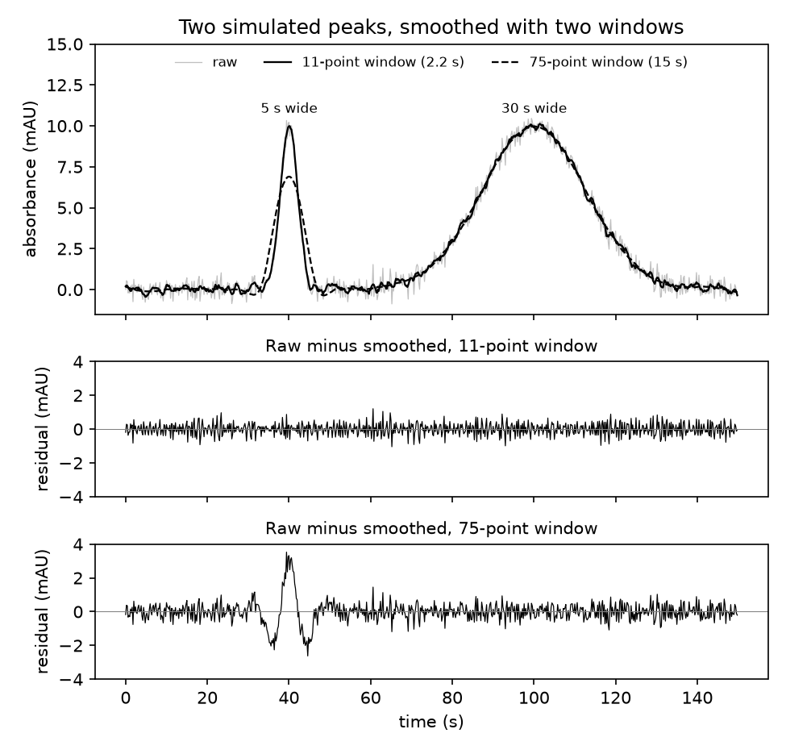
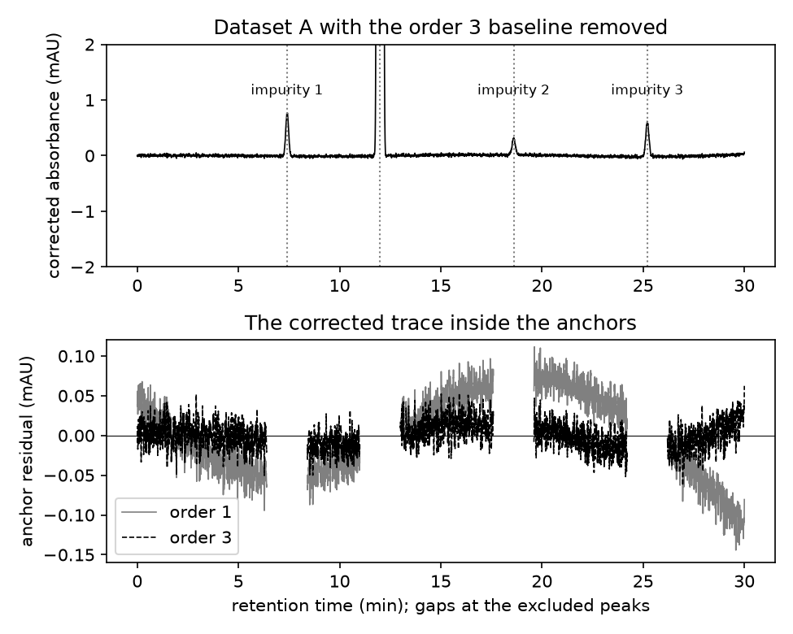

# Session 11: Filtering, smoothing, baseline correction

Thursday, November 5. A quality-control analyst decides which impurities in a batch of drug substance go into its batch record. The rule is a reporting threshold: an impurity is reported when its peak area is at least 0.05% of the main peak's area. Each method comes with a **method's table**, which lists the peaks it expects: the main peak and each known impurity, by name and retention time. On a chromatogram whose baseline climbs with the gradient, whether a small peak reaches 0.05% depends on how the baseline was removed. Today, for a simulated gradient HPLC-UV chromatogram with two candidate baselines, you determine which of its three impurities, each under 1 mAU tall, reach the threshold. You also ask the assistant for a plan written from the method's table, and check whether that plan holds for your own record.

## Learning objectives

By the end of this session you can:

1. Smooth a noisy trace with a Savitzky-Golay filter, and choose its window from the width of the narrowest peak that must survive. Show from the residual and the peak's height that the window kept the signal.
2. Remove a drifting baseline by fitting a polynomial through anchor regions that hold no peak. Read the anchor residual for a bow, which calls for a higher order, or a bump, which means a peak sits in an anchor.
3. Report a small peak's area as a percentage of the main peak's area, and say whether it reaches the reporting threshold. State the polynomial order and the anchor regions of the baseline that the percentage depends on.
4. Choose between two baseline orders from the anchor residual each leaves. Name the impurity that is reported under one order and not under the other.
5. Compare a coding assistant's plan with your own data before approving it. Change the plan where your data show a feature that the plan does not account for, such as a peak missing from the method's table.

**AI practice.** *Explore and plan before code*, met in session 7. In section 2 you ask the assistant, in Plan mode and in your own words, for a plan for removing your record's baseline and reporting each impurity, before the first look at your corrected record. Then you read the plan's anchors against that first look and decide what to change, or what you verified, before you approve. A three-line prompt record holds your prompt, what the plan proposed and what the first look showed, and what you changed or verified. The execution point needs it.

## 1. The reporting threshold and the batch record

An **impurity** in a drug substance is any component other than the active molecule. A batch record lists each impurity the method found, as a percentage of the main peak's area. The [ICH Q3A(R2) guideline](https://database.ich.org/sites/default/files/Q3A%28R2%29%20Guideline.pdf) sets three thresholds for a substance whose maximum daily dose is 2 g or less: a peak at or above 0.05% is reported, at or above 0.10% it must be identified, and at or above 0.15% its safety must be qualified. Today's decision is the reporting one.

The cost runs both ways. An impurity that grows from batch to batch is caught by the trend in the batch records. A peak left out at 0.05% leaves no trend to read. A stretch of baseline reported as an impurity sends a batch into an investigation for nothing.

Today's chromatograms are simulated by the course's generator, so the true area of every peak is known to the instructors. The method is a [gradient elution](https://en.wikipedia.org/wiki/Elution#Gradient_elution), in which the mobile phase's organic fraction rises through the run and the UV detector's baseline rises with it.

## 2. Savitzky-Golay smoothing: the window and the residual

Session 10's window broadened every line of a spectrum. A smoothing window does the same along a chromatogram. A [Savitzky-Golay filter](https://en.wikipedia.org/wiki/Savitzky%E2%80%93Golay_filter) fits a polynomial of low order, here 3, to the points inside a window, keeps the fit's value at the centre, and slides the window one point along. In the frequency domain it passes slow variation and attenuates fast variation, and the window's width sets the boundary between the two. A peak narrower than the window counts as fast variation, so the filter flattens it, whereas a peak several times wider than the window passes almost unchanged.

Choose the window from the narrowest peak that must survive, and check the choice two ways. The first check is the peak's height after smoothing. The second is the **residual**, the raw trace minus the smoothed trace, which should be noise with no shape. Figure 1 shows both checks on two simulated peaks.

*Figure 1. Two simulated peaks, 5 s and 30 s wide at half height, smoothed with an 11-point window (2.2 s) and a 75-point window (15 s). The 11-point window keeps 100% of the narrow peak's height and leaves only noise in the residual. The 75-point window keeps 69% of the narrow peak's height, and the residual inside that peak is 1.9 mAU rms against 0.4 mAU away from it. Look for the narrow peak's shape in the bottom panel. Neither window changes the wide peak.*

## 3. Polynomial baselines through anchors

A **baseline** is the signal the detector gives with nothing eluting. Under a gradient it drifts. To remove it, fit a polynomial through **anchors**, the points where no peak is, and subtract the fitted curve from the whole trace, under the peaks as well. Today's anchors are every point farther than 1.0 min from each listed retention time, 6,597 of the 9,001 points. `np.polyfit` fits it through the anchors on the raw trace and `np.polyval` evaluates it at every time.

The order is a choice about the baseline's shape. A straight line, order 1, says the drift is uniform through the run; order 3 allows two bends. The data decide between them through the **anchor residual**, the corrected trace inside the anchors, which should be noise with no shape. Figure 2 shows both on Dataset A. Under order 1 the residual bows: below zero before the main peak, above zero between 15 and 20 min, and 0.144 mAU below at the end of the run, in runs of one sign that last for minutes. Under order 3 it stays within 0.063 mAU of zero with no run of one sign.

*Figure 2. Dataset A with the order 3 baseline removed (top) and the corrected trace inside the anchors under both orders (bottom). Look for the bow in the order 1 residual, the baseline the straight line did not remove.*

The worked calculation, on Dataset A. A peak's area is the corrected trace summed over 0.4 min each side of its listed time, times the spacing of the points in minutes, in mAU min. The main peak's area is 178.7 mAU min under order 3, so the reporting threshold is 0.05% of it, 0.0893 mAU min. Impurity 2, at 18.6 min, reads 0.065% under order 1 and 0.039% under order 3, a difference of 0.027%. The difference is the bow: near 18.6 min the straight line runs about 0.06 mAU below the baseline, and 0.06 mAU over the 0.8 min window is about 0.05 mAU min, 0.027% of 178.7 mAU min. Order 1 reports all three impurities, whereas order 3 reports impurities 1 and 3. The generator's truth agrees with order 3. Across the 30 records, order 1 calls 35 of the 90 known impurities wrongly and order 3 calls none wrongly.

## 4. A new peak from a degradation product or a contaminant

A batch is not obliged to match the method's table. A degradation product or a contaminant gives a peak at a time the table does not name, and a baseline anchored on every point away from the listed peaks runs straight through it. The fitted curve is pulled up around the unlisted peak, so the corrected trace beside it sits below zero and the areas of its near neighbors are cut. A neighbor farther away can read high, where the curve dips to compensate. The unlisted peak itself loses only part of its area and is still reported. What changes is the analyst's call on each neighboring impurity, whether or not it reaches 0.05%.

The anchor residual shows the fault at once, as a bump at one time many times larger than the 0.063 mAU that Dataset A's residual reaches. The corrected trace shows a peak where the table has no mark. The fix is to exclude 1.0 min on each side of the new peak from the anchors and to add it to the peaks integrated. Section 2's first look prints the largest anchor residual and where it sits, before the anchor cell, so that you read your record and not only the table.

## 5. Explore and plan before code

A plan in words is cheaper to correct than code, and Plan mode is how you ask for one: click the mode indicator at the bottom of the Claude Code prompt box and choose **Plan**, or type `/plan` and a space before the request ([Claude Code in VS Code](https://code.claude.com/docs/en/vs-code)). Today the plan is the baseline step.

Read a plan against your own data, not against whether it sounds right. On Dataset A, four plans asked for this way all anchored the baseline on every point more than about 1 min from the four listed peaks. Three chose order 2 or 3 from the residual and a window of 11 to 21 points, and one compared orders 1 and 2. A plan built from the method's table and the worked example knows those four peaks. It may or may not add a clause about peaks the table does not list. The test is the same either way: does its anchor sentence cover what your first look shows? Where it does not, change the plan before you approve it; where it does, say what you checked it against.

## 6. Today

Your record is `record_NN`, your student number from session 4, one column of `data/records.csv`. In section 2 you choose the smoothing window (TASK 2), ask for the plan, look at your corrected record with section 1's anchors, record what the plan proposed and what you saw, and write the anchor cell yourself (TASK 3). Section 3 fits order 1 and order 3 through your anchors and shows which impurity is reported under one order and not under the other.

The judgment cell is scored 0 to 2 by the rubric in the syllabus. Part (a) asks which peaks go into the batch record and at what percent, with the numbers the notebook names. Part (b) is one entry with a reason from your output. Your prompt record is its natural source. To submit, click **Restart**, then **Run All**, save, and upload `activity.ipynb` to Canvas by 1:30 pm on Tuesday, November 10.

The area percent you report today depends on where the baseline was drawn. Session 12 asks where each peak starts and ends, on a gas chromatogram of lavender oil read against the pharmacopoeia.
