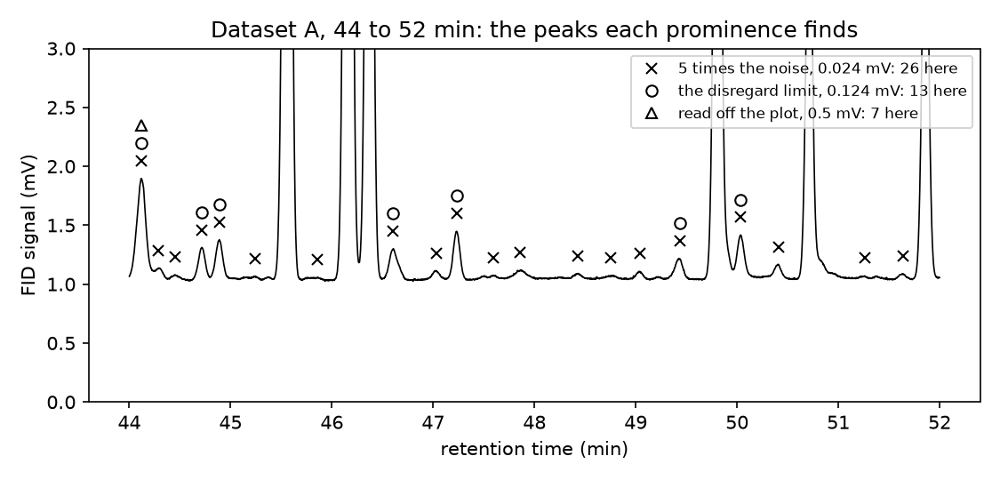
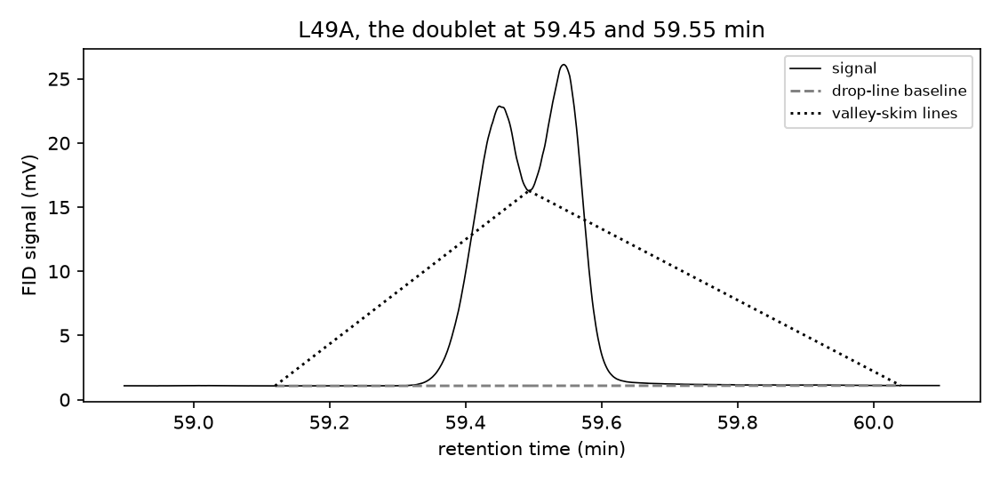

# Session 12: Peak detection and feature extraction

Tuesday, November 10. A quality analyst at a supplier or a pharmacy decides whether a commercial lavender oil meets the European Pharmacopoeia's profile, read as the area percent of three peaks in a gas chromatogram: camphor at most 1.2%, linalool 20.0 to 45.0%, and linalyl acetate 25.0 to 47.0%. Each percentage depends on which peaks are counted and where each starts and ends. Today you choose those settings on three runs of one oil from a [published dataset of 55 commercial oils](https://doi.org/10.17632/pgkrc7wyj4.1), and find whether your oil's call depends on them.

## Learning objectives

By the end of this session you can:

1. Choose peak-detection settings from the measurement: a prominence from the smallest peak that must count, and a width and a spacing from the narrowest peak. Say what a lower setting invents and a higher one misses.
2. Integrate each peak between bounds set by its neighbors, by a drop-line or a valley-skim rule. Report its area as a percent of a total whose peaks you can name.
3. Decide whether a sample meets a specification from three replicate runs, with their spread and the distance to the nearest limit.
4. Show how far a second integration rule moves each result. Say whether the call depends on the rule.
5. Write a skill for a step you repeat. Check its table against one you built by hand, and decide whether to change the skill before using it on new data.

**AI practice.** *A SKILL.md for a repeated step*, new today. After section 1 you save its method as a skill from a template with four blanks and run it on Dataset A in a new conversation. You decide whether its values match your hand-built table within 0.01 points, and if not, what in `SKILL.md` to change, then run it on your runs beside TASK 3's table. A three-line prompt record holds your prompt, both comparisons, and what you changed or verified, and the execution point needs it.

## 1. Area percent and the pharmacopoeia's profile

The [European Pharmacopoeia monograph on lavender oil](https://www.drugfuture.com/Pharmacopoeia/EP7/DATA/1338E.PDF) (Ph. Eur. 1338) reads a gas chromatogram with flame ionization detection (GC-FID) by **normalization**: each peak's area as a percentage of the summed area of all peaks, its **area percent**. A peak under 0.05% of that sum falls below the **disregard limit** and is left out of it.

[Linalool](https://pubchem.ncbi.nlm.nih.gov/compound/Linalool) and [linalyl acetate](https://pubchem.ncbi.nlm.nih.gov/compound/Linalyl-acetate) are true lavender oil's two largest peaks, at 42.88 and 43.29 min, and [camphor](https://pubchem.ncbi.nlm.nih.gov/compound/Camphor) is a small peak at 40.37 min. The files name no peak, so the three were placed by the monograph's elution order, and camphor was confirmed by its mass spectrum (<i>m</i>/<i>z</i> 152, 108, 95 and 81) in one oil.

Wrong one way, an oil cut with lavandin, a cheaper hybrid richer in camphor, or with synthetic linalool is sold as pharmacopoeial. Wrong the other, a genuine lot is rejected and its supplier loses the sale. Of 51 oils sold as true lavender, [Pokajewicz, *Farmacja Polska* (2025)](https://doi.org/10.32383/farmpol/211704) classed 51% as genuine and the rest as lavandin, lavandin with synthetic additions, or artificial mixtures.

All three percentages share one denominator, so a peak counted or missed anywhere moves all three. Section 2 sets which peaks count.

## 2. Peak detection: noise, prominence, width and spacing

`find_peaks` from SciPy returns the local maxima that meet the settings you give it. A peak's **prominence** is how far its apex rises above the higher of the lowest points on either side before taller signal, so a small peak on a large one's flank is measured from where it rises. Its **width** is taken at half the prominence, in points, and the **distance** is the fewest points allowed between two apexes.

The **noise**, from 25 to 33 min where Dataset A holds no peak, is the standard deviation of the differences between neighboring points divided by the square root of 2, 0.0048 mV.

The worked calculation starts from the smallest peak that counts. The peaks found at 5 times the noise total 31.09 mV min, so a peak at the disregard limit has 0.0155 mV min. The narrowest peak at least 1 mV prominent is 35.3 points wide at half height, 3.5 s or 0.0588 min. A Gaussian peak's area is its height times that width times 1.064, so

height = 0.0155 mV min / (1.064 × 0.0588 min) = 0.248 mV,

the area of a 0.05% peak divided by 1.064 times the narrowest width. The prominence is half that height, 0.124 mV, so a 0.05% peak on a neighbor's flank is still found. The width setting is half the narrowest width, 17.6 points, and the distance the whole width, 35 points.

A lower prominence finds noise: 5 times the noise, 0.024 mV, finds 122 peaks, and the disregard limit drops all but 54. The derived setting finds 58 and keeps 53. A higher one misses real peaks: 0.5 mV, read from how the plot looks, misses 21 the derived setting keeps, 14 of them between 0.05 and 0.1%. The data system's own table, in each file, lists 38.

*Figure 1. Dataset A from 44 to 52 min, with the apexes found at 5 times the noise (crosses), at the disregard limit (circles) and at 0.5 mV (triangles). Look for small peaks circled but without a triangle.*

The width setting drops spikes narrower than any real peak, and the distance keeps one apex per peak: without it, a flat-topped apex comes back twice, 0.3 s apart. Section 3 sets where each peak starts and ends.

## 3. Integration: bounds, drop-line and valley skim

A peak's **bounds** are the lowest points of the signal between its apex and each neighbor's apex, searched at most 300 points, 0.5 min, away. Its area, in mV min, is the signal above a baseline between the bounds, summed by `trapezoid`.

- The **drop-line** rule draws one baseline through the bounds that sit on the true baseline, within 0.05 mV of the lowest signal 0.3 min either side, and splits a cluster by a vertical line at each valley.
- The **valley-skim** rule draws a straight line under each peak between its own two bounds, so the area under a shared valley belongs to neither peak.

The worked calculation continues, by drop-line at the derived setting. Linalool's area is 10.59 mV min and the 53 kept peaks total 30.81 mV min, so linalool is 10.59 / 30.81 × 100 = 34.37%, its area over the kept total, as a percent. The data system gives 35.16%, 0.80 points higher, because its 38 peaks make a smaller total. By valley skim it reads 34.49%: the rules agree wherever the signal returns to the baseline, as it nearly always does in Dataset A. An area percent is complete only with the list of peaks its total includes.

Figure 2 shows where they part, on run A of the solution's oil, which no student holds. Two peaks share a valley at 16.3 mV, far above the baseline near 1.1 mV, and the drop-line gives them 1.81 and 1.88 mV min. Each skim line rises from an outer bound to the valley across the peak's outer flank, where it runs above the signal and the skim subtracts the area between them. Both skim areas are negative, −1.02 and −2.28 mV min, one more reason a valley that does not return to the baseline calls for the drop-line. The skim also shrinks the run's total from 22.24 to 18.54 mV min, and linalool rises from 19.16 to 22.97%, across the 20.0% limit.

*Figure 2. A doublet whose valley does not return to the baseline, with the drop-line baseline (dashed) and the valley-skim lines (dotted). Look where the dotted lines cross the signal.*

Section 4 sets how far from a limit a value must sit for its call to hold.

## 4. Replicate runs and the margin to a limit

A component's mean over runs A, B and C is the result, and their standard deviation is the **replicate spread**. The **margin** is the distance from the mean to the nearest limit, in percentage points. A margin many times the spread holds; one smaller than the spread could reverse with the next run, and the report says so.

A call depends on the rule only where the rule's shift exceeds the margin. In Dataset A, linalool sits 10.63 points from its nearest limit, 45.0%, against a shift of 0.12 points, and camphor 0.95 points under 1.2%, so Dataset A meets all three limits under either rule. The data system's value comes from a different list of peaks, so quote it beside yours, not in its place.

## 5. A SKILL.md for a repeated step

A **skill** is a file of instructions, `SKILL.md`, in a folder under `.claude/skills/`, that Claude Code runs as a command when you type `/` and its name ([Claude Code skills](https://code.claude.com/docs/en/skills)), for a step you repeat. Its header gives the `name` and a `description` of when to use it; the body is the method, with `$ARGUMENTS` standing for what you type after the command, here a run's path.

The body states every choice of section 1 as a number, from the stretch searched to each component's time and range. The template gives every window in points, because a looser wording is read one way by the assistant and another by your code. In the course's trials, "no bound more than 0.5 min from its apex" gave tables 0.02 to 0.07 points from the hand-built one, and a skill that stated no baseline chose a flat line at the run's minimum and read Dataset A's linalool at 30.75%.

The check is to run the skill once on data whose answer you know. A skill that follows the method reproduces Dataset A's hand-built table within 0.01 points, the last digit of a rounding. A larger difference points at a step in `SKILL.md` to change before the skill reads your runs, and TASK 3's table is the second check. That order, a known answer first and new data second, holds for any skill you write.

## 6. Today

Your oil is beside your student number from session 4 in `data/samples.csv`. Section 2 asks for `SAMPLE` (TASK 1), your settings (TASK 2), the skill's runs and your own table in a code cell you add (TASK 3); section 3 compares the rules.

The judgment cell is scored 0 to 2 by the rubric in the syllabus. Part (a) asks whether your oil meets the profile, citing each component's mean and spread, its margin, the other rule's shift and the data system's value. Part (b) is one entry with a reason from your output; your prompt record is its natural source. To submit, click **Restart**, then **Run All**, save, and upload `activity.ipynb` to Canvas by 1:30 pm on Thursday, November 12.

Your call rests on three distances read together: the margin, the spread and the rule's shift. A drop-line splits a doublet by a vertical line at its valley; session 13's `curve_fit` offers the alternative, a peak shape fitted to each.
