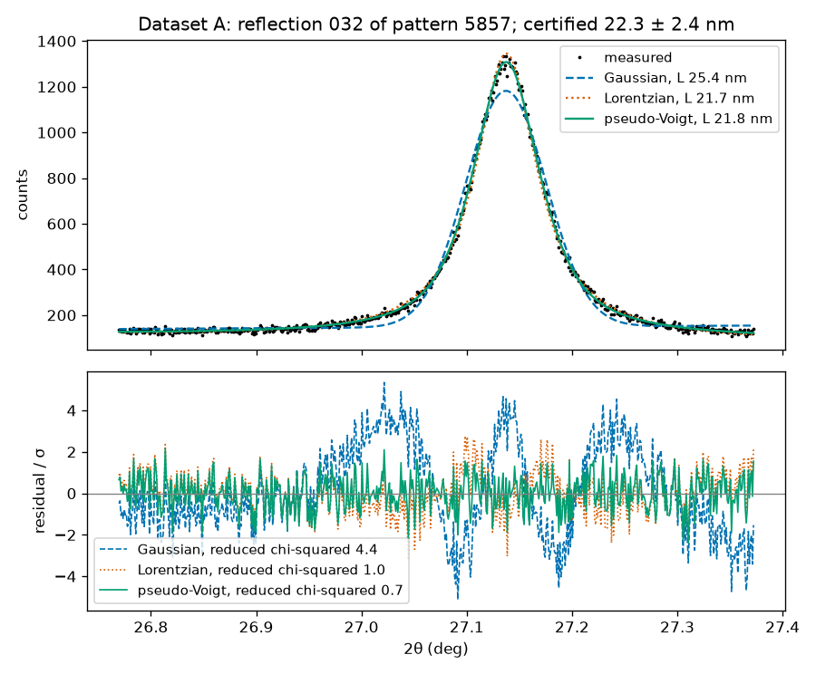

# Session 13: Curve fitting

Thursday, November 12. A laboratory that reports nanoparticle sizes from X-ray diffraction validates its method on a certified standard first. The method fits a profile to one diffraction line, turns the breadth of the fit into a crystallite size, and compares it with the value the National Institute of Standards and Technology (NIST) certifies for that line. Today you find whether such a method passes on one reflection of [NIST Standard Reference Material 1979](https://doi.org/10.18434/M32269), a nanocrystalline zinc oxide powder, from the patterns NIST measured to certify it, and whether the profile you fit changes your call. A method validated by luck reports a biased size on every powder after it.

## Learning objectives

By the end of this session you can:

1. Fit a model function to measured points with `curve_fit`, from a starting guess and bounds taken from the physics of the measurement. Carry each parameter's standard error from the covariance matrix to the quantity the decision needs.
2. Read a residual plot to tell a profile the data support from one they do not. State what a laboratory that skipped that check would have reported.
3. Choose a peak profile from the mechanism that broadens the line, and show how far a profile chosen for convenience moves the result.
4. Decide whether a method passes validation against a certified value and its stated uncertainty. Give the margin to the interval's edge, and say whether a second defensible profile would change the call.
5. Write a prompt that names the model, the weights, the bounds and the quantity to report. Check the answer against a cell that recomputes those quantities.

**AI practice.** *Specific prompts* (from session 5). Before TASK 2 in section 2 you ask the assistant, in your own words, for the cell that defines the mixed profile and fits it to your reflection. You decide, from the given cell after it, whether the answer used the weights and the bounds and set the names needed, and, from the certificate, which of its cautions hold. A three-line prompt record holds your prompt, what the answer added, and what you verified or rejected, and the execution point needs it.

## 1. Crystallite size from line broadening

A **crystallite** is a region of a particle that diffracts as one crystal, and a 15 nm crystallite holds too few repeats of the lattice for sharp reflections. A line's breadth therefore measures the size, by the [Scherrer equation](https://en.wikipedia.org/wiki/Scherrer_equation):

L = λ / (β cos θ)

The size L is the wavelength divided by the line's breadth β, in radians, times the cosine of half the diffraction angle 2θ; which size depends on which breadth. When β is the **integral breadth**, the line's area divided by its height above the background, L is the volume-weighted mean column length ⟨L⟩vol, the mean length of the columns of unit cells along the diffraction vector. When β is the full width at half maximum (FWHM) with a constant near 0.9 in front, L is a different average, which a certificate of ⟨L⟩vol cannot validate. A comparison with a certified value starts by matching the measurand.

[SRM 1979](https://tsapps.nist.gov/srmext/certificates/1979.pdf) is a zinc oxide powder made for this check. Its certificate gives ⟨L⟩vol for 22 reflections, with an expanded uncertainty U at a coverage factor of 2, from the Fourier analysis in [Cline et al., *Journal of Research of NIST* (2020)](https://doi.org/10.6028/jres.125.020). Ten of the reflections are marked "breadth unaffected by stacking faults"; a [stacking fault](https://en.wikipedia.org/wiki/Stacking_fault) is a misplaced layer that cuts the columns short, so the other reflections' certified values are smaller, with that broadening inside them.

The decision is the laboratory's: a method whose size lands inside the certified interval is validated, and one outside is sent back. Wrong one way, every catalyst, pigment or sunscreen size it reports is biased; wrong the other, a method that works is revalidated. Section 2 sets how a profile is fitted to a line.

## 2. Fitting a model to measured points

A **model function** says what the measurement should look like for a few parameters, and a fit finds the values at which it comes closest to the points. For counts the distance is weighted: each point's difference from the function is divided by its uncertainty σ, near the square root of the count, and the sum of the squared ratios is minimized. SciPy's [curve fitting function](https://docs.scipy.org/doc/scipy/reference/generated/scipy.optimize.curve_fit.html), `curve_fit`, returns `popt`, the best parameter values, and `pcov`, the **covariance matrix**, with each parameter's variance on its diagonal and the ties between parameters off it. The standard error of a quantity computed from the parameters follows by propagation through the whole matrix. The weights are passed as `sigma`, and `absolute_sigma=True` takes them as true uncertainties.

A fit begins at a **starting guess**, `p0`, and finds the nearest minimum, not the best one. Without a guess every parameter starts at 1, and the optimizer stops wherever the gradient vanishes, far from the peak. The guess comes from the physics: the centroid where the certified lattice puts the reflection, the width a crystallite of the label's size would give by the Scherrer equation read backwards, the area as breadth times height, the background from the window's ends. **Bounds** then keep the fit where the physics allows: the centroid near the lattice position, a mixing fraction between 0 and 1, an area and a width above zero. A parameter that ends on a bound is a warning: the data want a function outside the family. Section 3 says which family to choose.

## 3. Profiles and residuals

Three shapes cover most lines. A **Gaussian** falls off as the exponential of the squared distance from the centroid, with light tails. A **Lorentzian** falls off as the inverse of the squared distance, with heavy tails, the shape small crystallites produce, and a stacking fault adds broadening of the same shape. A **pseudo-Voigt** is a mixture, a fraction η of a Lorentzian plus 1 − η of a Gaussian of the same area, centroid and FWHM, so one parameter says where between the two the line sits ([Voigt profile](https://en.wikipedia.org/wiki/Voigt_profile)). Each shape's integral breadth is a fixed multiple of its FWHM, 1.064 for a Gaussian and 1.571 for a Lorentzian.

The fit cannot say which shape is right. The **residual plot** can. Each residual is the measured count minus the fitted value, divided by the point's σ. A profile the data support leaves residuals scattered about zero, and their mean square per point beyond the parameters, the [reduced chi-squared](https://en.wikipedia.org/wiki/Reduced_chi-squared_statistic), sits near 1. A profile with tails lighter than the line's leaves bands, the measured tails above the fit and the shoulders below, and the reduced chi-squared climbs with them. Figure 1 shows the three profiles on Dataset A.

*Figure 1. Dataset A with a Gaussian (dashed), a Lorentzian (dotted) and a pseudo-Voigt (solid) and their residuals. The Gaussian gives 25.4 nm, outside the certified 22.3 ± 2.4 nm, with a reduced chi-squared of 4.4; the Lorentzian 21.7 nm and the pseudo-Voigt 21.8 nm, inside, with 1.0 and 0.7; the pseudo-Voigt's η is 0.83. Look for the Gaussian's bands at the top, the shoulders and the flanks.*

A Gaussian's size reads high because its light tails make its breadth too small, and on some reflections it still lands inside the certified interval while the residuals show the bands. The method is not validated by that landing. Section 4 turns a fitted size into a call.

## 4. Validating against a certified value

The call compares two intervals: the fitted size plus and minus two standard errors, and ⟨L⟩vol plus and minus U. When the method's interval lies inside the certificate's, the method passes; when the two do not overlap, it fails; otherwise the call is **undecided**. On patterns this good the fit's standard error is a fraction of a percent, so the certificate's uncertainty, about a tenth of the value, sets the call, and the **margin**, the distance to the nearer edge of the certified interval, says how firmly a pass holds.

Two things move a size that the profile does not. The first is a neighbouring line. A window ends halfway to the next reflection, and a strong neighbour's tail reaches across and lifts one end of the window, so the fitted background tilts, the line reads too narrow and the size too large. The residuals rise at the window's edges; the notebook names the neighbour and reports the residuals at both edges, and an undecided call with lifted edges is the window's doing, not the method's. A weak line can be undecided with flat edges, when its standard error reaches the certified edge; a second reflection settles that. The second is the instrument's own breadth: on a high-resolution synchrotron beamline a few percent of a 15 nm line's, inside the certified uncertainty, so the notebook leaves it in; on a laboratory diffractometer comparable to the line's, measured with a line-shape standard such as [SRM 660c](https://tsapps.nist.gov/srmext/certificates/660c.pdf) and subtracted.

The notebook fits the Gaussian beside your pseudo-Voigt and reports both calls, so that you can say what a laboratory fitting Gaussians would have certified. Section 5 is about asking for the fit.

## 5. Specific prompts

A prompt that asks for a fit names six things: the notebook and the task; the form of the model and the order of its parameters; the names the cell must set; how the fit is weighted; what bounds hold; and what to report, in which units, and how to check it. A prompt that names a peak and asks for a size leaves all six to the assistant.

In the course's trials the specific prompt came back with an explanation of what the weights and the bounds change, the fitted numbers and a procedure for checking them by hand; the vague prompt came back with the code, unrun. On a reflection marked as affected by stacking faults, every answer also added an unasked caution, that such a reflection cannot validate the method, which is wrong for this standard, whose certificate holds a value for each such reflection. A caution is a claim like any other: check it against a document you hold.

## 6. Today

Your pattern and reflection are beside your student number from session 4 in `data/reflections.csv`. Section 1 is read and run on Dataset A. Section 2 is your reflection: TASK 1 sets it, TASK 2 is the mixed profile and its fit, and a pair Explain cell compares your η with a neighbor's. Section 3 fits the Gaussian beside it.

The judgment cell is scored 0 to 2 by the rubric in the syllabus: part (a) is your call with its evidence, part (b) one entry with a reason from your output or the certificate. To submit, click **Restart**, then **Run All**, save, and upload `activity.ipynb` to Canvas by 1:30 pm on Tuesday, November 17.

Your call rests on the margin, the residuals of the profile you chose, and what the other profile would have certified; the fit's standard error is the smallest distance today, and session 14 is about what it leaves out.
