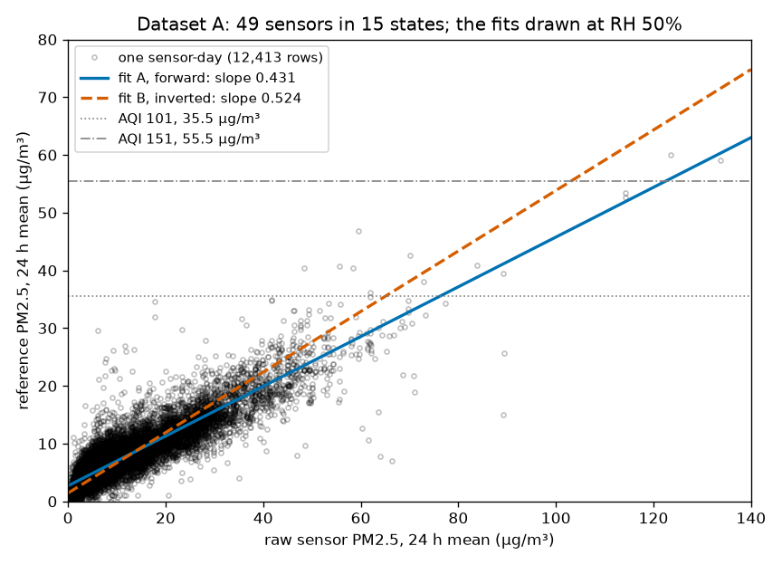

# Session 14: Uncertainty and model selection

Tuesday, November 17. A school district that maps low-cost air sensors lets a principal move recess indoors when a sensor's corrected 24 hour mean of fine particles, PM2.5, reaches an air quality index (AQI) breakpoint. Someone chooses the correction that turns the raw reading into that number and says how sure it is. Today you choose a correction by its error on data it has never seen, estimate its uncertainty by resampling, and count the days at your own two sensors on which no correction can say which side of a breakpoint the air was on. The data are EPA's sets of PurpleAir sensors beside regulatory monitors. A wrong map keeps children indoors on clean days, or sends them outside in smoke.

## Learning objectives

By the end of this session you can:

1. Choose between two models by their error on data held out of the fit. Hold the data out in groups, so that the test is as new as the data the model will meet.
2. Estimate a fitted correction's uncertainty by a bootstrap over the unit that is independent. Say what the standard error from the covariance matrix leaves out.
3. Carry a correction's uncertainty and the scatter of single days to a decision threshold. Count the cases the measurement cannot call.
4. Choose the direction of a calibration fit from the false alarms and misses each direction makes at the threshold.
5. Decide the resampling unit before asking the assistant for a bootstrap. Correct the first answer at once if it draws another unit, and record what it drew.

**AI practice.** *Correct early, and clear the context* (from session 8). Before TASK 3 in section 2 you decide what each resample of the bootstrap should draw, from the rule in section 3 below, and only then ask the assistant for the cell in your own words. If the first answer draws something else, you say so at once, in one sentence that names the unit and the reason. A three-line prompt record holds your prompt, what the first answer drew and your correction, and what the given cell showed for your unit against rows. The execution point needs it.

## 1. Fine particles, light-scattering sensors and the AQI

**PM2.5** is the mass of particles 2.5 µm across or smaller in a cubic metre of air, in µg/m³ ([EPA, particulate matter basics](https://www.epa.gov/pm-pollution/particulate-matter-pm-basics)). Regulatory monitors measure it by weighing particles collected on a filter, or with an instrument EPA has approved as equivalent, at a few sites in each city. A low-cost sensor draws air past a laser, counts the light the particles scatter, and turns the counts into a mass with an assumed density and refractive index.

The scattering depends on what the particles are. Particles that take up water swell in humid air and scatter more light for the same dry mass, and smoke particles differ in size and refractive index from the particles the sensor was set up for. Each is a matrix effect. A **correction** is a calibration of the sensor against a regulatory monitor, fitted where the two stand side by side, which is called **collocation**.

The decision rests on the 24 hour mean. EPA's AQI breakpoints, in force since May 2024 ([EPA fact sheet](https://www.epa.gov/system/files/documents/2024-02/pm-naaqs-air-quality-index-fact-sheet.pdf)), put AQI 101 at 35.5 µg/m³ and AQI 151, the red "Unhealthy" category, at 55.5 µg/m³. A day at or below 35.4 µg/m³ met the 24 hour standard. The Washington State Department of Health's [wildfire smoke summary for schools](https://doh.wa.gov/sites/default/files/2025-08/334-431-WIldfireSmokeSCHOOLSummary.pdf) advises shortening, moving or cancelling children's outdoor activity at AQI 101, and cancelling or moving it at AQI 151.

A call can be wrong two ways. A **false alarm** calls a breakpoint the reference did not reach, and when the reference met the standard, children lost recess for clean air. A **miss** leaves a day uncalled that the reference put over the breakpoint, and children played outside in smoke. Section 2 chooses the correction.

## 2. Choosing a model by held-out error

A fitted model's error on the points it was fitted to flatters it, because the fit chose its parameters to make exactly those errors small. The test that chooses between models is the error on data left out of the fit, called [cross-validation](https://en.wikipedia.org/wiki/Cross-validation_(statistics)): fit on all but one part of the data, predict that part, and repeat until every part has been left out once. The **mean absolute error**, the average size of the difference between predicted and measured values, summarizes each model.

What to leave out depends on where the model will be used. Points that share a source share its errors: days at one sensor share its optics and its calibration, and sensors in one state share weather, humidity and the kind of particles in the air. Leaving out single days lets the fit see the same sensor's other days, an easier test than new data. Leaving out a whole state tests the model the way a new city's sensors will. The model with the lower held-out error is chosen, and a term that lowers the error in most groups earns its place. Section 3 asks how well its coefficients are known.

## 3. Uncertainty: the standard error, a bootstrap, and the scatter of one day

`curve_fit`'s covariance matrix, from session 13, gives a standard error for each coefficient and, by propagation, for any value computed from them. It assumes that every point is an independent measurement and that every point scatters by the same amount. Points that share a source err together, so the data hold less information than their count suggests and the standard error comes out too small. A scatter that grows with concentration breaks the second assumption.

A **bootstrap** estimates the uncertainty without those two assumptions ([bootstrapping](https://en.wikipedia.org/wiki/Bootstrapping_(statistics))). Draw a resample as large as the data, with replacement, refit, and repeat a thousand times; the spread of the refitted values is the uncertainty. A bootstrap is only as honest as what it draws. Draw whole the unit that errs together, with all of its points, so that one resample differs from the next as much as a new set of sensors would. Draw single points from data that come in groups, and the resamples look more alike than new data would, so the spread comes out too narrow. A unit can also be too large: with few groups, each resample repeats or drops a large share of the data, and the spread is itself poorly known. Which unit errs together depends on how the data were collected, not on the code, and you decide it before you write the code.

The spread of the refitted line is the uncertainty of the correction. One day also scatters about the line, by more near the breakpoints than on clean days, and that scatter is the standard deviation of the residuals of days in that range. The two are independent, so they add in quadrature:

σ = √(σ_line² + σ_day²)

The uncertainty σ of one corrected day is the square root of the line's variance plus one day's variance. A day whose corrected value lies within 2σ of a breakpoint is a day the map cannot call: the reference could lie on either side. For a normal scatter, 2σ covers about 95% of days. When σ_day is much larger than σ_line, a better line barely changes σ. Section 4 asks which way to fit the line.

## 4. Forward and inverse calibration

A calibration can be fitted in two directions. The **forward** fit takes the reference as y and the sensor reading as x, and gives the corrected value directly. The **inverse** fit, the usual [calibration curve](https://en.wikipedia.org/wiki/Calibration_curve) of analytical chemistry, takes the sensor reading as y, a response to the true concentration, solved for the concentration. Both minimize squared errors in y only. When x also scatters, the fitted slope is pulled toward zero, an effect called [regression dilution](https://en.wikipedia.org/wiki/Regression_dilution). The forward fit's x is the sensor, which scatters more than the reference, so its slope is flattened: it predicts best near the middle of the data and reads low at high concentration. The inverse fit keeps the sensor's own response and reads higher there.

*Figure 1. Dataset A, reference against raw reading, with fit A, forward, slope 0.431, and fit B, inverted, slope 0.524, both drawn at 50% relative humidity. Fit B reaches AQI 151 at a raw reading of 103 µg/m³, fit A at 123. Between the two lines' crossings of the dash-dot line, the fits make different calls.*

Both directions are defensible, and EPA's published correction is the inverse fit ([Barkjohn and colleagues, 2021](https://doi.org/10.5194/amt-14-4617-2021)). At a breakpoint, though, the direction chooses the kind of error. On a smoky day the forward fit reads low and misses, and the inverse fit reads high and gives false alarms. The analyst who chooses for the district says which error costs more, from the counts at the sensors in question.

## 5. Correcting a first answer early

The practice from session 8 carries to any request whose answer turns on one choice. Make the choice before you ask, and read the first answer for it. In the course's trials, a prompt that pointed at an existing loop over rows got that loop back with its names changed, and a caution; one sentence naming the unit and its reason, sent at once, fixed it in one turn. A prompt that asked only for "the code for TASK 3" got a question back, which unit, and no code; that is the decision the practice asks you to make first. A claim the output can test, such as two spreads that "should roughly agree", is checked against the printed numbers. After two corrections that do not take, start again: type `/`, choose **Clear conversation**, and send a first prompt that names the unit.

## 6. Today

Your two sensors are beside your student number from session 4 in `data/sensors.csv`. The first cell of section 1 downloads both EPA sets into `data/`, about a minute; we will post the files on Canvas if EPA refuses. Section 1 is read and run on Dataset A, the US-wide 24 hour set. Section 2 is your two sensors in the hourly smoke set: TASK 1 sets them, TASK 2 keeps one copy of each sensor-hour, and TASK 3, after your prompt, is the bootstrap you write. A pair Explain cell compares your σ and your days within 2σ with a neighbor's. Section 3 sets the inverse fit beside the forward one, at both breakpoints.

The judgment cell is scored 0 to 2 by the rubric in the syllabus: part (a) is the fit you would give the district, with your counts at both breakpoints, and part (b) one entry with a reason from your output. To submit, click **Restart**, then **Run All**, save, and upload `activity.ipynb` to Canvas by 1:30 pm on Thursday, November 19.

The fit's standard error from session 13 is the smallest of today's uncertainties. At a breakpoint, one day's scatter sets how many days a map can call.
