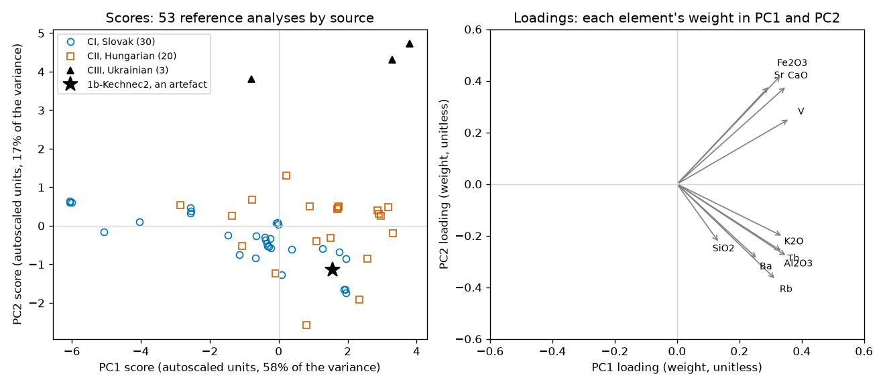

# Session 15: Principal component analysis

Thursday, November 19. An archaeologist who finds a flake of obsidian at a prehistoric site decides which volcano it came from: the Slovak sources of the Carpathian 1 group, the Hungarian sources of Carpathian 2, or neither. The call rests on an X-ray fluorescence analysis of ten elements in the flake, set against analyses of samples collected at the sources. Today you reduce those ten elements to a few principal components, read what each component measures, and test whether your own artefact belongs to a source, on Petřík and Prokeš's analyses of Carpathian obsidian. A wrong call puts a site's supply on the wrong side of a mountain range.

## Learning objectives

By the end of this session you can:

1. Choose between centering and autoscaling from the variables' units and variances. Show what the choice does to the first component and to a call.
2. Read a scores plot and its loadings in chemical terms. Tell a component that measures composition from one that measures how the sample was measured.
3. Choose the number of components from the scree plot and from how often held-out references are rejected. Say what the number does to a call.
4. Decide whether an unknown belongs to a reference class from its two distances to the class's model and their limits, including "neither" when the data say so.
5. Review your notebook in a fresh context. Check each finding against the cell it names before you act on it, and record one you fixed or rejected.

**AI practice.** *A fresh-context review.* After section 3's Explain cell, before the judgment cell is finished, you save the notebook, open a new conversation that has not seen your work, and type the review prompt printed there, as written. The answer is a numbered list of findings naming cells, and you decide which are real by opening each cell. One finding you fixed or rejected, with the reason, goes in the three-line prompt record, which the execution point needs, and is the expected source of part (b).

## 1. Obsidian, its sources, and the cost of a wrong call

[Obsidian](https://en.wikipedia.org/wiki/Obsidian) is volcanic glass, a silica-rich melt that cooled too fast to crystallise. [Williams-Thorpe, Warren and Nandris (1984)](https://doi.org/10.1016/0305-4403(84)90001-3) defined two chemical groups, Carpathian 1 (C1) around Viničky and Cejkov in the Zemplín hills of Slovakia and Carpathian 2 (C2) in the Tokaj mountains of Hungary; [Rosania and colleagues (2008)](https://www.antiquity.ac.uk/projgall/rosania318/) added Carpathian 3 (C3) in Transcarpathian Ukraine. The sheet's codes CI, CII and CIII are those groups.

Sourcing works because obsidian from one eruption is nearly uniform and eruptions differ: in a survey of silicic obsidians, [Macdonald, Smith and Thomas (1992)](https://doi.org/10.3133/pp1523) found the more evolved melts richer in rubidium and uranium and poorer in calcium, strontium and barium, and the ratios between the two kinds separate sources. An energy-dispersive X-ray fluorescence (ED-XRF) spectrometer excites the flake with X-rays and reads each element's concentration from the X-rays it emits in return. The beam sees a surface, so a small or curved flake returns less of everything, by a similar factor for every element.

Each wrong call has a cost. Called Slovak when it was Hungarian, or the reverse, the site's supply moves to the wrong side of the hills and a regional reading moves with it: [Bonsall and colleagues (2017)](https://www.ceeol.com/search/article-detail?id=597132) read eleven artefacts from five Bulgarian sites as a shift from C2 obsidian before about 5900 cal BC to C1 after it, and call it tentative; one mis-sourced piece in a set that small can make or unmake it. Called "neither" when it was one of the two, a link the data carry goes unpublished.

## 2. Centering, autoscaling, and the covariance matrix

Ten elements per analysis make a cloud of points in ten dimensions. [Principal component analysis](https://en.wikipedia.org/wiki/Principal_component_analysis) (PCA) finds the directions along which the cloud is widest: the eigenvectors of the [covariance matrix](https://en.wikipedia.org/wiki/Covariance_matrix), ordered by the variance each carries. Each component is a weighted sum of the elements, and the weights are its **loadings**.

Each column is first centered, its mean subtracted. Centering alone keeps each column's variance, in the column's units squared, so a column in parts per million outweighs one in weight per cent by thousands, and the first eigenvector points along it. **Autoscaling**, also called [standardization](https://en.wikipedia.org/wiki/Feature_scaling), divides each centered column by its standard deviation, so every column enters with variance one and the components follow the correlations between elements instead of their units.

The rule: columns with different units or spans are autoscaled. Columns that share a unit, where the large values are the ones that matter, as in a spectrum, are centered only. Either way the scaler is fitted to the reference set, and a new sample is scaled with the references' mean and standard deviation. Note that a sample scaled by its own statistics lands at the origin, which says nothing about where it belongs.

## 3. How many components

The share of the variance each component carries, drawn in order, is the [scree plot](https://en.wikipedia.org/wiki/Scree_plot), and its running total says how much of the data a model with k components keeps. One rule reads k off the scree, at the elbow. A better rule for a model that will accept or reject samples tests it as it will be used: hold out each reference in turn, fit without it, and ask whether the model accepts it. The k with the fewest held-out rejections is the one to keep.

Too few components leave real composition in the residual, and the model rejects its own kind. Too many model the reference set's own scatter, which no new sample repeats, and it rejects its own kind again.

## 4. Reading scores and loadings

A sample's **scores** are its coordinates along the components; a scores plot of the first two shows the references marked by source. The loadings say what each axis measures. A component on which every element has a loading of the same sign measures how much of everything a sample returned: the same composition, more or less diluted. A component that sets some elements against others measures composition, a ratio that dilution cannot move.

On a small flake the first kind appears whether or not it is wanted. Six references were measured three times, and each triplicate's analyses sit on top of one another. Two references were measured in both of the deposit's measurement campaigns, and for the one the notebook follows, the campaigns put it at different places along the all-positive component and the same place along the ratio component. The deposit's authors used log-ratios of the elements, the standard treatment of [compositional data](https://en.wikipedia.org/wiki/Compositional_data), which removes dilution; the course checked that section 5's calls mostly agree and does not compute it.

*Figure 1. The references' autoscaled scores and loadings. Every loading points right, so PC1 measures how much of everything an analysis returned; the loadings split up and down, so PC2 measures a ratio, strontium, calcium, iron and vanadium against rubidium, thorium and potassium. Slovak and Hungarian analyses overlap on PC2 and differ along PC1; the Ukrainian source sits apart on PC2. The star is the solution's artefact.*

The two campaigns also explain why three of the sheet's elements are not used: uranium, manganese and titanium read far lower in the second campaign for the same specimens, whereas the ten kept elements read within a factor of two. The data README gives the factors.

## 5. One-class models: T², Q, and their limits

A **one-class model** of a source is a scaler and a PCA fitted to that source's analyses alone, with k components, and a new analysis has two distances to it. [Hotelling's T²](https://en.wikipedia.org/wiki/Hotelling%27s_T-squared_distribution) is the squared distance of its scores from the source's centre within the model's plane, each component's distance divided by that component's variance. Q is the squared distance from the plane. Each has a limit that the source's own analyses exceed with a small probability, one in twenty in the notebook: T²'s from the F distribution ([Jackson, 1991](https://doi.org/10.1002/0471725331)), Q's from a chi-squared approximation. Inside both limits, the analysis belongs to the source; outside either, it does not.

Two sources give four calls. Inside one model only, the artefact is CI or CII. Inside both, the sources overlap where it sits, and the data cannot separate them. Inside neither, it is off both planes: an unsampled source, a weathered surface, or a measurement that went wrong. The limits assume many, normally scattered references; with a few dozen they are optimistic, by the amount the held-out test of section 3 shows, and a "neither" is read with that in mind.

## 6. A fresh-context review

A conversation that helped build a notebook shares its assumptions; a reviewer with nothing but the file reads what is there. Save the notebook, open a new conversation in a new tab, and send the review prompt the notebook prints. It asks for four kinds of finding, each naming a cell: anything that would stop a top-to-bottom run, a number in a markdown cell that disagrees with its output, a figure without units or without the sentence after it, and a scientific choice made outside Parameters. For the judgment cell it asks only whether each part cites a number that is in the output.

The reviewer reads the saved outputs and cannot see a figure, so a number you took from a plot comes back as unconfirmed, not as wrong: open the cell it names and look. It names a cell by an id stored in the file, which the editor does not show, so find the cell by the words the finding quotes. A finding you reject with a reason is as good an entry as one you fix. The review costs five to ten questions' worth of your usage limit. You use it again on the final project in session 19.

## 7. Today

Your artefact's name is beside your student number in `data/assignments.csv`. Section 2 is your artefact: TASK 1 sets its name, TASK 2 is the projection onto the references' model, a cell you write whole, and a given cell prints its T² and Q against each source as ratios to the limits. A pair Explain cell compares your call with a neighbor's; if no neighbor is ready, use the solution's artefact, 1b-Kechnec2: autoscaled ratios 0.09 and 0.48 against the Hungarian model and 0.30 and 1.77 against the Slovak, a CII call at every number of components. Section 3 makes the same call centered and autoscaled, and then comes the review.

The judgment cell is scored 0 to 2 by the rubric in the syllabus: part (a) is the source you would give the archaeologist, with your ratios under both scalings and what the call costs if wrong, and part (b) one entry from the review with a reason from your notebook. To submit, click **Restart**, then **Run All**, save, and upload `activity.ipynb` to Canvas by 1:30 pm on Tuesday, November 24.

The scaler and the number of components are choices you defend; the limits turn them into a call.
