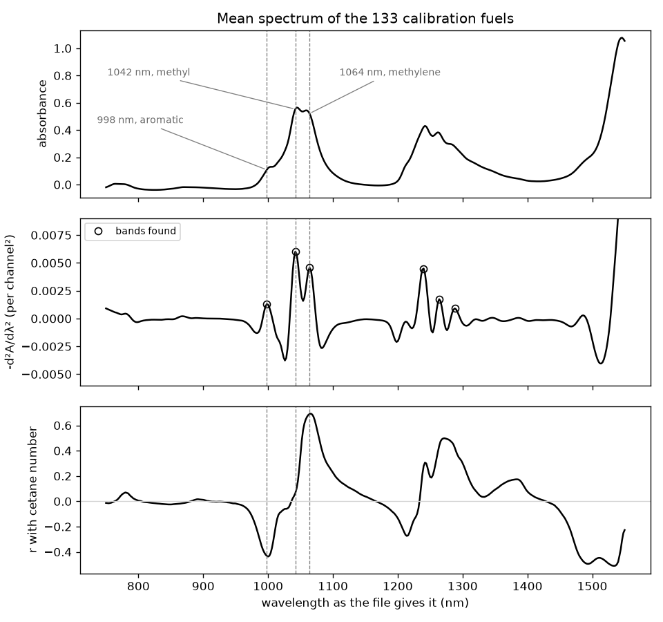

# Session 17: Calibration and multivariate models

Tuesday, December 1. A refinery or export terminal in the United States decides whether a batch of diesel can be loaded on a cargo for Europe, where the minimum cetane number is 51.0, or is sold at home, where it is 40. A near-infrared (NIR) spectrum of the fuel can stand in for the engine test that measures cetane number, if a calibration predicts it well enough. Today you build calibrations from one wavelength up to every wavelength, choose the size of a partial least squares model, and call your own fuel against 51, on Southwest Research Institute's NIR spectra of diesel fuels.

## Learning objectives

By the end of this session you can:

1. Read a calibration on one wavelength and an inverse least squares (ILS) model on a few. Say from the spectrum and the coefficients why each band is there.
2. Show from the calibration and validation errors why a model on every wavelength fails, and name the cause.
3. Choose the number of latent variables in a partial least squares (PLS) model from its error on validation samples. Report that error, not the calibration error, in the property's units.
4. Call a sample against a specification limit from a prediction and its error. Compare the model's error with the reference method's precision as numbers of the same kind.
5. Write a line in `CLAUDE.local.md` from something an assistant's first answer did that you would want done differently. Check from a second answer whether it was followed.

**AI practice.** *Keep a CLAUDE.md*, reused from session 10. After TASK 3 you ask the assistant in your own words whether your fuel meets 51 and how sure that call is, and read the answer before you act on it. You write one line in `CLAUDE.local.md` from something it did that you would want done differently, clear the conversation, and ask again. A three-line prompt record holds your prompt, your line and what changed, and the execution point needs it.

## 1. Cetane number, the engine test, and two limits

The [cetane number](https://en.wikipedia.org/wiki/Cetane_number) measures how readily a fuel ignites by compression. A fuel with a high cetane number ignites soon after injection; a low one waits longer, then burns too much at once. ASTM D613 measures it in a single-cylinder engine whose compression ratio is varied until the fuel's ignition delay matches that of a blend of reference fuels, n-hexadecane (cetane) at 100 and heptamethylnonane at 15.

Cetane number follows the hydrocarbons in the fuel. Chevron's *Diesel Fuels Technical Review* (2007) gives straight-chain alkanes high cetane numbers that rise with chain length, and aromatics low ones, below 20 for two or three fused rings. A diesel holds a few hundred such compounds, so its cetane number is a property of the mixture.

Two limits apply to the same fuel. [ASTM D975](https://dieselnet.com/standards/us/fuel_diesel.php) requires at least 40 for grades No. 1-D and No. 2-D; [Directive 2009/30/EC](https://eur-lex.europa.eu/eli/dir/2009/30/oj), Annex II, requires 51.0 for diesel sold in the European Union. The same review says that smoothness, misfire, smoke, noise and ease of starting all depend on ignition quality.

Each wrong call has a cost. Called at or above 51 when it is below, the batch arrives off specification, and the seller pays to blend it with higher-cetane stock or dose it with a cetane improver such as 2-ethylhexyl nitrate before it can be sold. Called below 51 when it meets the limit, a batch fit for the cargo is sold where the limit is 40, and the export sale is lost.

## 2. One wavelength: Beer's law on a band

By the [Beer-Lambert law](https://en.wikipedia.org/wiki/Beer%E2%80%93Lambert_law), A = ε b c: a band's absorbance is the molar absorptivity times the path length times the concentration of the one absorber. A calibration on one wavelength writes the property as a straight line in the absorbance, y = b₀ + b₁ A(λ): an intercept plus a slope times the absorbance at wavelength λ.

One wavelength is enough when one component absorbs there, nothing else does, and the baseline holds still. To find a candidate, plot the correlation coefficient, r, between each channel's absorbance and the property across the calibration samples. An NIR spectrum of a hydrocarbon mixture fails all three conditions: its bands are overtones and combinations of C-H stretching from every molecule at once, overlapping into broad humps. The negative of the second derivative, from session 11's Savitzky-Golay filter, separates them into peaks.

*Figure 1. The calibration fuels' mean spectrum, its negative second derivative and each channel's correlation with cetane number, on the file's axis. The dashed lines mark the first group's three bands: the correlation is negative at the first, near zero at the second and largest just past the third.*

[Ma and colleagues (2019)](https://doi.org/10.1038/s41598-019-45945-y) place the second overtone of aromatic C-H near 1140 nm, of methyl C-H near 1190 nm and of methylene C-H near 1210 nm, with a combination band near 1400 nm. The file's bands sit about 150 nm below those positions. The course uses the axis as the file gives it and reads the first group's three bands as aromatic, methyl and methylene from their order and the signs of their coefficients.

## 3. Classical and inverse least squares

Classical least squares (CLS) writes a sample's spectrum as the sum of its components' pure spectra, each scaled by its concentration, and fits the concentrations. It needs the pure spectrum of every absorber. Diesel rules it out: a few hundred hydrocarbons have no pure spectra here, and cetane number is not a concentration.

Inverse least squares regresses the property on the absorbances at a few wavelengths, y = b₀ + b₁ A(λ₁) + b₂ A(λ₂) + ..., one coefficient per wavelength, fitted to calibration samples whose property the reference method measured. It needs no pure spectra, and a coefficient's sign says which way the property moves when that band rises with the others held fixed. Choose the wavelengths at separate bands of the second derivative.

## 4. Collinearity and more wavelengths than samples

Two channels 2 nm apart on one band rise and fall together; their absorbances are **collinear**. Given both, least squares can trade one coefficient against the other, and the coefficients grow large and opposite in sign with little gain in error over one channel alone.

With at least as many coefficients as calibration samples, the calibration error can reach zero whatever the chemistry. This is [overfitting](https://en.wikipedia.org/wiki/Overfitting), and only samples the model was not fitted to can say how well it predicts.

The error is the root-mean-square error, RMSE = √(Σ(ŷᵢ − yᵢ)² / n): the square root of the mean squared difference between each prediction and its reference value, in the property's units. On the calibration samples it is the RMSEC; on validation samples, which no model was fitted to, it is the validation error. Note that both describe only fuels like the calibration set; a fuel outside its range is an extrapolation.

## 5. Partial least squares

PLS keeps every channel and avoids the collapse. It builds a few **latent variables**, each a weighted sum of all the absorbances, chosen one at a time as the direction that varies most strongly with the property once earlier ones are removed, and regresses the property on them. In session 15, principal components followed the variance of the data alone, so the first component of a set of spectra can be the baseline. A PLS latent variable follows its covariance with the property. Every channel shares one unit, so the spectra are mean centered and not autoscaled.

Too few latent variables leave chemistry out, and both errors stay high. Too many fit the calibration samples' noise: the RMSEC falls with each one added, whereas the validation error stops falling and rises. Today's rule is to choose the number where the validation error is lowest, and report that error.

That makes three sets: the calibration set fits the models, the validation set chooses their size and measures their error, and the records are used for neither. Note that an error measured on the samples that chose the model is slightly optimistic. Session 18 answers that with cross-validation.

## 6. Calling a sample against a limit

A prediction several validation errors from the limit gives a call that holds. A prediction within one error of the limit cannot be told from the limit, and the honest call is that the model cannot decide.

The reference method has its own error. Van Gerpen's [*Cetane Number Testing of Biodiesel*](https://biodieseleducation.org/Literature/Journal/2006_Van_Gerpen_Cetane_number_testin.pdf), citing the 1988 edition of ASTM D613, gives a repeatability of 0.7 to 0.9 and a reproducibility of 2.5 to 3.3 cetane numbers for fuels between 44 and 56. Reproducibility is the difference that two laboratories' results on one fuel exceed about once in twenty. It is a limit, not a standard deviation: ISO 5725-6 sets it at 2.8 times the standard deviation of one laboratory's result: 1.96, for one in twenty, times √2, since two results differ. A validation error is a standard deviation, so it is compared with the reproducibility divided by 2.8. The limit itself is for the receiving terminal's retest: an engine value within it of 51 is a close call.

## 7. Keep a CLAUDE.md

Your conventions go in `CLAUDE.local.md`, beside `CLAUDE.md`; Claude Code reads both at the start of every conversation ([How Claude remembers your project](https://code.claude.com/docs/en/memory)). If you kept your line from session 10, today's goes under it.

A line that works names something an answer visibly does or does not do, states a convention for every answer rather than a fact about today's data, and can be checked against the next answer part by part. Today's line comes from whatever the first answer did that you would want done differently every time. Read the answer in the chat; decline its edits to the notebook.

## 8. Today

Section 1 downloads the files and works one wavelength, three and all 401 on Dataset A, 133 calibration fuels and 82 validation fuels. Section 2 is your fuel, beside your student number in `data/assignments.csv`, one of 30 records kept out of both sets. TASK 2, the latent-variable curve and your choice, is a cell you write whole. If no neighbor is ready for the pair Explain, use the solution's fuel, 22461: PLS predicts 51.69, and the engine gave 54.2. The practice follows TASK 3, and section 3 sets the two models' calls side by side.

The judgment cell is scored 0 to 2 by the rubric in the syllabus: part (a) is whether your batch goes on the European cargo, and part (b) one entry, from your prompt record or elsewhere. To submit, click **Restart**, then **Run All**, save, and upload `activity.ipynb` to Canvas by 1:30 pm on Thursday, December 3. Today is also the last day to ask your mentor for a project data exemption, and your draft and check-in scores are on Canvas.

A prediction makes a call only when it lies further from the limit than its error.
